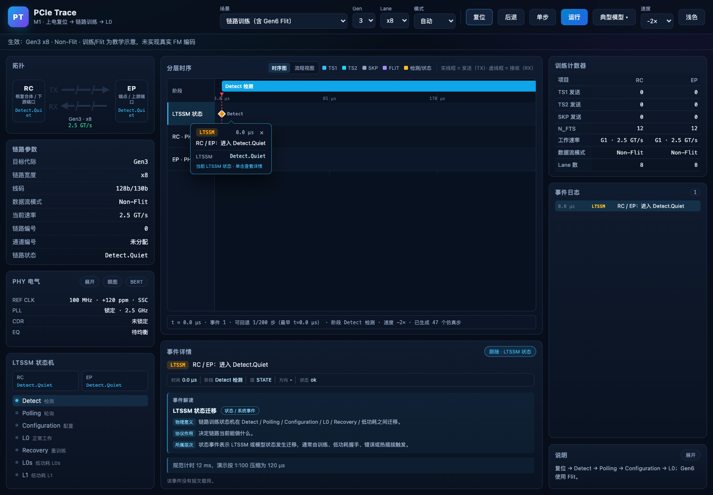

# M0–M1 本地升级交付

日期：2026-11-17；应用版本：0.2.0；分支：`upgrade/m0-m1-accuracy`。

用户已确认实施 M0–M1。本轮完成该阶段的本地改造与验证，未推送、未部署，GitHub Pages 线上仍为原版本。改动当前保留在本地工作区。

## 改动

1. **M0 基线**：冻结 51 个原应用文件及 11 个参考文件的 hash；保存来源提交、原测试结果与旧探针；建立 [规则登记](M0_RULE_LEDGER.md) 和 10 组独立 NFM 报文头向量。
2. **回退/调度**：Flit 可变对象纳入快照，事件包与事件记录不可变；拒绝过去和非有限时间，保留同时刻稳定顺序，运行达到步数上限可查 `stopReason`；界面显示历史数量及最早时间。
3. **TLP/Completion**：修复请求头字段顺序、CfgRd Length、首尾 BE、长度特殊编码、4KB/载荷/输入校验；完整 64 位地址无损表示；修复拆包 Byte Count=128→64、写后读回=32；枚举中配置写增加 Cpl，与链路 Ack 分开。
4. **配置空间**：自然对齐的 8/16/32 位访问和字节使能；所选寄存器的 RO/RW/RW1C；BAR 类型位、独立高低 DWORD 探测、部分写和无损基址。Type 1 明确仅为参考布局。
5. **能力约束**：13 场景共用能力注册，builder 入口和 UI 均校验。未支持配置明确拒绝、不静默切换；用户修正配置后可恢复。Gen6 训练与 Flit 示意保留，低速 FM 训练示意也保留；FM 事务实验暂不开放。
6. **Flit 校准**：删除伪 CRC-32+反码和伪 ECC 运算，保护字节置零占位；显式标注 NFM 头占位、非标准 DLP、未执行真实校验；故障 outcome 显式指定，不由误码 bit 数推导标准能力。
7. **检查框架**：增加核心测试和浏览器冒烟的 GitHub Actions 配置；浏览器依赖仅用于开发，静态运行仍无依赖。测试发现并修复自动事件浮窗遮挡视图切换按钮的问题。

## 验证结果

| 检查 | 结果 | 说明 |
| --- | --- | --- |
| Node 测试 | **96/96 通过** | 保留原场景回归并按规范更新错误 BAR 预期；新增字段、边界、配置、回放与配置收敛测试 |
| 全模式能力矩阵 | **1170 组合通过接受/拒绝路径检查** | 13 场景 × 6 代际 × 5 宽度 × 3 模式；605 支持、565 拒绝；不是全面合规认证 |
| 逐步回退重放 | **13 场景通过** | 默认有效配置下比较完整快照、事件载荷和队列元信息，覆盖历史保留范围 |
| 外部头编码交叉验证 | **10/10 通过** | 与本地 cocotbext-pcie 对比协议头 DWORD，见 [结果](M1_REFERENCE_RESULTS.json) |
| 更新后的默认模式探针 | **320 执行通过、70 正确拒绝、0 异常** | 原 390 组合改为区分产品能力，见 [结果](M1_AUDIT_RESULTS.json) |
| 浏览器冒烟 | **15/15 通过** | macOS 本机无头 Chrome；真实 `/pcie-sim/` 子路径；13 场景及两项自动收敛流程；约 25 秒，仅为测试运行时长 |
| 浏览器资源/异常 | **通过** | 冒烟场景检查页面异常及 HTTP 资源错误 |
| Git diff 格式检查 | **通过** | `git diff --check` |

浏览器首轮 3 项因自动浮窗遮挡按钮而失败，已限制浮窗在时间轴区域内；修复后完整重跑 15 项通过，没有通过强制点击绕过问题。

GitHub Actions 仅新增配置，本轮没有推送，因此没有远端 CI 执行结果。Firefox/WebKit 和窄屏完整验收留在后续计划。

## 复验

```sh
npm test
node scripts/audit.mjs
python3 scripts/check-reference-vectors.py ../cocotbext-pcie-master

npm ci
npm run test:browser                  # 本机有 Chrome 时
# 使用 Playwright 管理的 Chromium：
npx playwright install chromium
PCIE_BROWSER_CHANNEL=chromium npm run test:browser
```

浏览器回归自动启动仅监听 127.0.0.1 的临时静态服务。CI 的独立浏览器 job 会安装 Chromium；本地 Node 核心测试不依赖浏览器包。

## 兼容变化和限制

- `bytes` 仍为逻辑 DWORD 顺序、DWORD 内小端的显示表示，不能直接当分析仪抓包。NFM 请求字节布局与旧版不兼容，属于纠错变更。
- `buildMem()` 的长度、BE、地址或载荷不合法会抛错，不再静默截断。`buildCpl()` 的 Byte Count 接受语义值 1–4096，4096 编码为零；不接受把 0 当完成标记。
- 超过安全整数范围的 TLP 地址为 BigInt；当前 UI 可显示十六进制，后续 JSON 导出必须使用字符串/高低 DWORD。BAR 快照已经使用无损十六进制字符串。
- 64 位 BAR 的低 DWORD 读值/探测值保留类型位，因此例子从 `0x80000000` 改为 `0x80000004`；基址仍为 `0x80000000`。
- 非法配置、FM 尚未实现的组合、非自然对齐配置访问仍会被拒绝；界面会把场景/速率/模式收敛到最近的合法组合，在能力提示中写明「已自动调整 Gen6 → Gen5」之类的改动后继续运行，不再停在无法播放的状态。
- Flit `checkFlit()` 只是兼容名称的示意结果记录器，返回 `simulated=true/verified=false`。故障须显式给 `outcome`；不代表 CRC/FEC 校验器。
- **M2 未执行**：信用耗尽仍不阻塞、BERT 零样本判定与置信区间仍待修复，高级场景仍为示意子集。**M5 未执行**：真实 FM TLP/DLP/CRC/FEC 尚未实现。

## 当前界面



下一审核停点为此 M0–M1 本地版本；未经后续指令，不自动推进 M2 或发布线上。
